# Glassify Tab

A customizable Chrome new-tab extension inspired by iOS and visionOS. Glassify Tab combines a liquid-glass interface, website shortcuts, and productivity widgets in a personal dashboard.

## Screenshots

### Dashboard

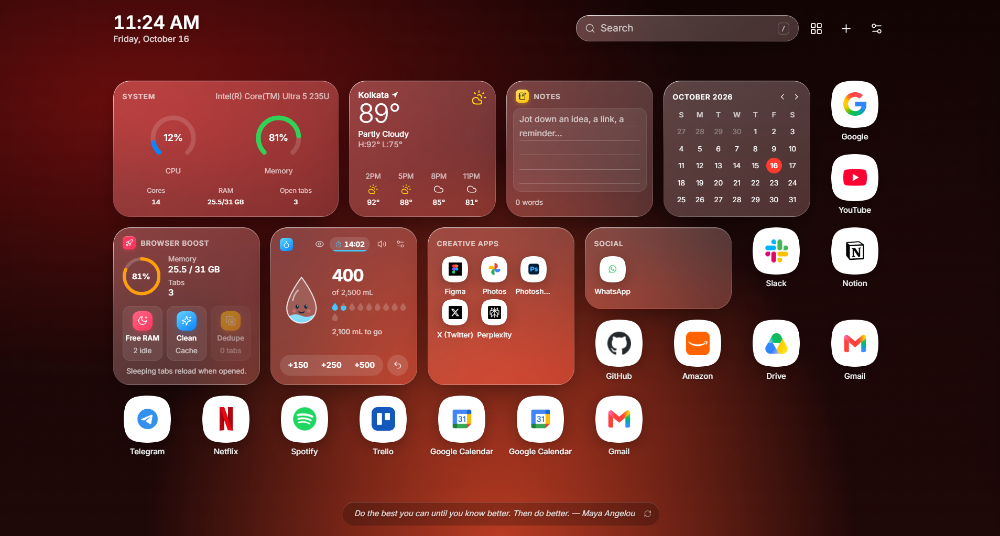

### Spaces

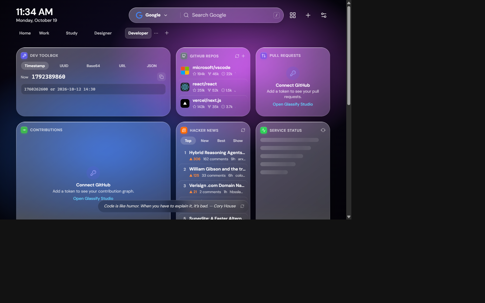

Use Spaces to keep separate shortcut and widget layouts for different activities. Starter spaces include Work, Study, Designer, and Developer; each can be edited, renamed, or deleted. Home remains as the protected fallback, and appearance settings are shared across spaces.

### Glassify Studio

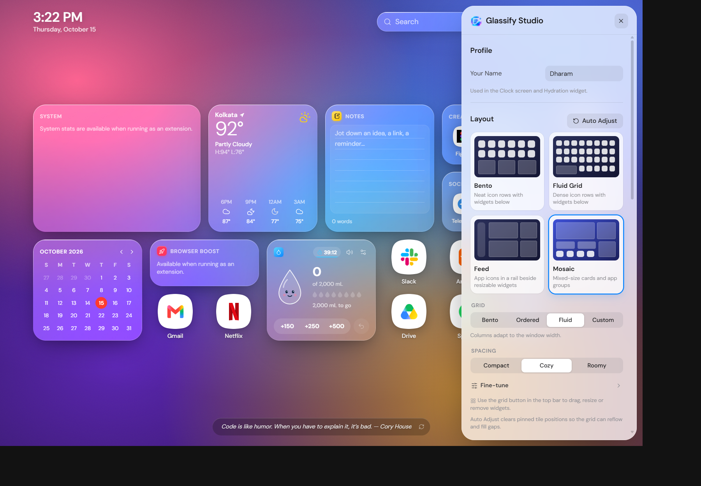

### Theme & Wallpaper

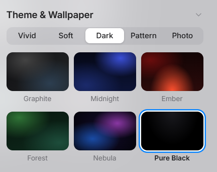

### Layout Gallery

| Bento | Fluid Grid |
| --- | --- |
| 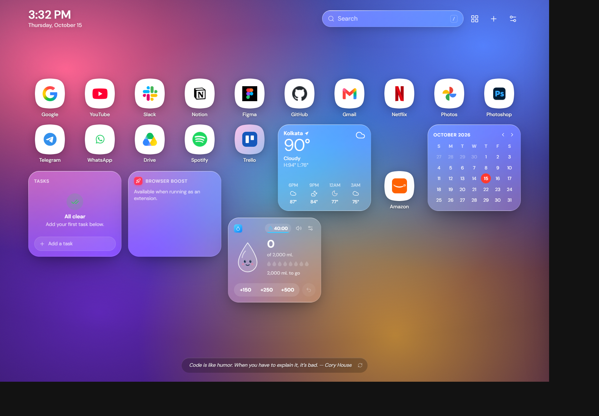 | 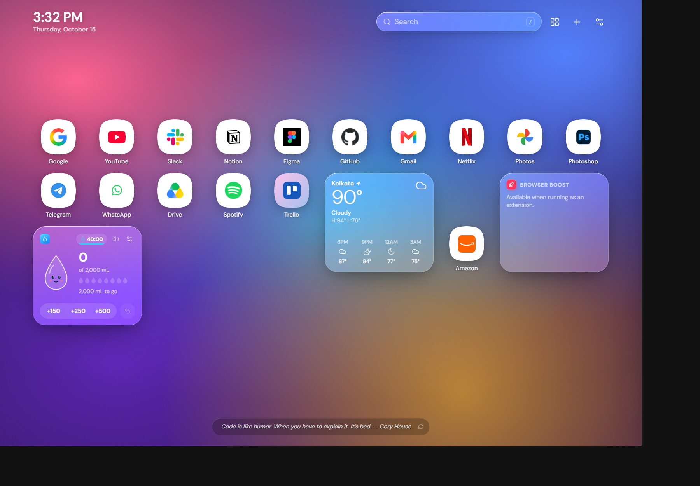 |

### Feed Layout

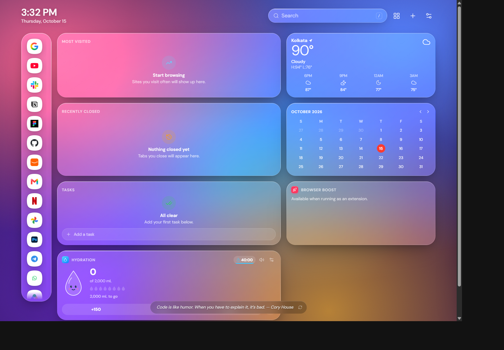

### Widget Library

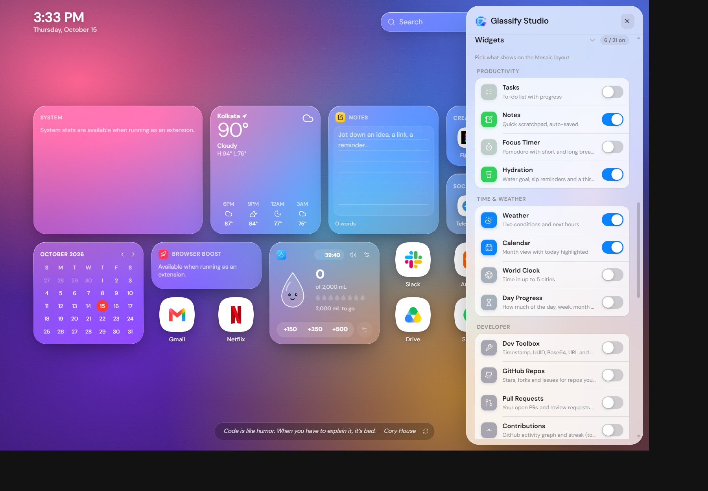

### Clock Screen

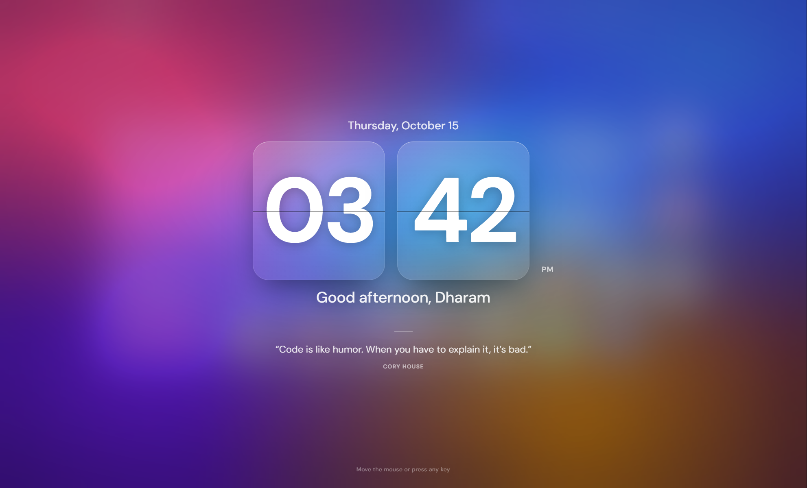

Choose Classic, Bold, Digital, Flip, or Analog in Glassify Studio's Clock Screen settings. Use Preview to open the clock immediately, or enable Show When Idle to display it automatically.

Captured in the local web preview. Chrome-only widgets require the installed extension. These documentation images live in `docs/screenshots` and are not included in the production `dist` build.

## Features

- **Flexible layouts:** Bento, Fluid Grid, Feed, and Mosaic presets, with grid and spacing controls.
- **Personal appearance:** Built-in wallpapers, custom photo uploads, font selection, and glass-style controls through Glassify Studio.
- **Website shortcuts:** Editable tiles with custom icons or text fallbacks, plus app groups.
- **Spaces:** Keep separate shortcuts and widget layouts for Home, Work, Study, Designer, and Developer.
- **Productivity tools:** Tasks, auto-saved notes, a Pomodoro timer, hydration tracking, and a local reading queue.
- **Mindfulness:** An optional 20-20-20 eye-break reminder with a quiet 20-second rest prompt.
- **Time and weather:** Local conditions, a calendar, world clocks, and day-progress indicators.
- **Developer dashboard:** GitHub activity, pull requests, package information, news, snippets, and utility tools.
- **News digest:** Optional RSS headlines from technology, world, business, and Hacker News feeds.
- **Browser tools:** Most-visited sites, recently closed tabs, resource monitoring, and browser cleanup actions.
- **Idle display:** A customizable clock screen when the dashboard is idle.
- **Settings backup:** Export and import dashboard settings and shortcut tiles as JSON.

## Widget Reference

Enable or remove widgets through Glassify Studio. Widget selection and ordering can differ between layouts.

| Category | Widget | Purpose |
| --- | --- | --- |
| Productivity | Tasks | Manage a to-do list and track completion. |
| Productivity | Notes | Keep an auto-saved scratchpad. |
| Productivity | Focus Timer | Run Pomodoro sessions with short and long breaks. |
| Productivity | Hydration | Track water intake, set a daily goal, and receive sip reminders. |
| Mindfulness | Eye Break | Every 20 minutes, look about 20 feet away for 20 seconds; pause or finish breaks anytime. |
| Finance & Feeds | RSS News Digest | Browse cached technology, world, business, and Hacker News headlines. |
| Time & Weather | Weather | View current conditions and upcoming hours. |
| Time & Weather | Calendar | Browse a month view with today highlighted. |
| Time & Weather | World Clock | Track time in up to five cities. |
| Productivity | Reading Queue | Save links to read later, mark them read, or open the next unread article. |
| Developer | Dev Toolbox | Work with timestamps, UUIDs, Base64, URLs, and JSON. |
| Developer | GitHub Repos | Follow repository stars, forks, and issues. |
| Developer | Pull Requests | View your open pull requests and review requests; requires a GitHub token. |
| Developer | Contributions | View GitHub activity and streaks; requires a GitHub token. |
| Developer | Hacker News | Read top, new, best, and Show HN stories. |
| Developer | npm Packages | View package versions and weekly downloads. |
| Developer | Snippets | Save commands and copy them quickly. |
| Developer | Localhost | Keep shortcuts to local development servers. |
| Browser | Most Visited | Access frequently visited websites. |
| Browser | Recently Closed | Reopen recently closed tabs. |
| Browser | Browser Boost | Free memory, clear cache, and close duplicate tabs. |
| System | System Performance | Monitor CPU usage, memory, and tab count. |

### Widget Screenshots and Usage

See the [complete widget guide](docs/widgets.md) for screenshots, controls, and setup requirements for all 22 widgets.

| Tasks | Notes | Focus Timer |
| --- | --- | --- |
| 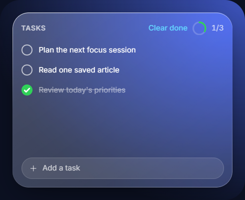 | 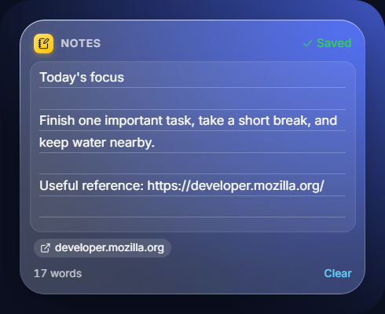 | 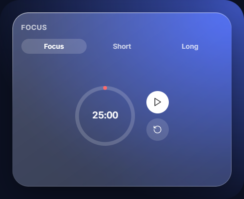 |

## Requirements

- Node.js 18+ and npm for local development and builds.
- Google Chrome with support for Manifest V3 extensions.
- Internet access for live weather, GitHub, news, and package data.

## Local Development

Clone the repository and install dependencies:

```sh
git clone https://github.com/dharam-gfx/glassify-tab.git
cd glassify-tab
npm install
```

Start the development server:

```sh
npm run dev
```

Open the local URL printed by Vite. This previews the dashboard with hot reload.

The browser preview uses localStorage instead of Chrome extension storage. Preview data and installed-extension data are separate. Features that depend on extension APIs, including background reminders, browser tab tools, and system information, require the installed extension.

## Install in Chrome

Build the extension after installing dependencies:

```sh
npm run build
```

1. Open `chrome://extensions`.
2. Enable **Developer mode**.
3. Click **Load unpacked**.
4. Select the generated `dist` folder, not the repository root or `public` folder.
5. Open a new tab to use Glassify Tab.

After changing source files, run `npm run build` again, click **Reload** on the extension at `chrome://extensions`, and open a fresh new tab. The installed extension does not automatically use changes from the Vite development server.

## Customize Your Dashboard

Open **Glassify Studio** from the dashboard to change its appearance and content.

1. Choose a layout preset and adjust grid behavior and spacing.
2. Select a built-in wallpaper or upload your own photo.
3. Adjust fonts, tile appearance, and other visual settings.
4. Add the widgets you need and arrange the dashboard in edit mode.
5. Edit shortcut tiles to change their destinations, labels, and icons.
6. Optionally set your name for the clock screen and Hydration widget.

### Hydration Buddy

The Hydration widget supports water goals, intake tracking, a monthly report, and reminder settings. A buddy can appear on the dashboard when a drink is overdue.

| Water Tracker | Reminder Settings |
| --- | --- |
| 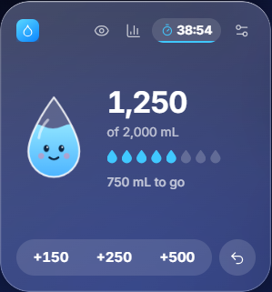 | 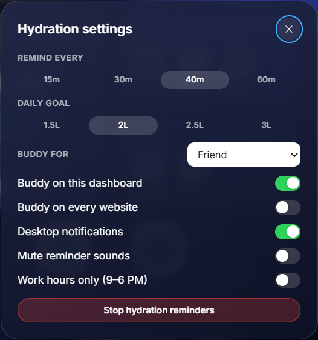 |

Log a drink with the +150, +250, or +500 mL controls and use Undo to reverse the last drink. The gear button opens a settings popup for the daily goal, reminder interval, buddy behavior, notifications, and **Mute reminder sounds**. Use **Stop hydration reminders** at the bottom of the popup to pause every reminder, notification, and buddy appearance, including on other websites; the card shows "Stopped" until you choose **Resume hydration reminders**.

#### Monthly Report

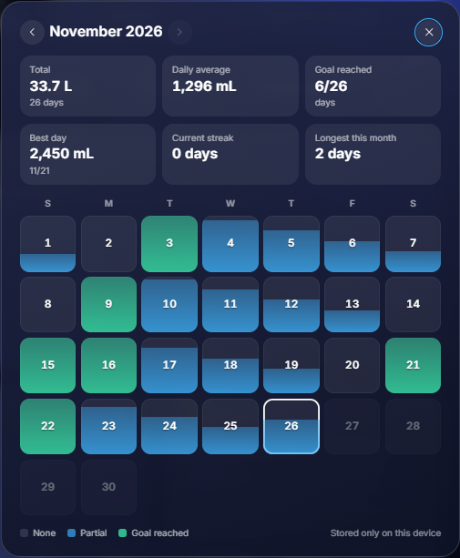

The bar-chart button opens a monthly report with the total, daily average, goal-reached days, best day, current streak, and a calendar where each day fills to show how much you drank. Use the arrows to browse earlier months. History is stored only on your device (about the last 800 days) and the layout adapts to the window size. The screenshot uses sample data.

#### Roaming Buddy

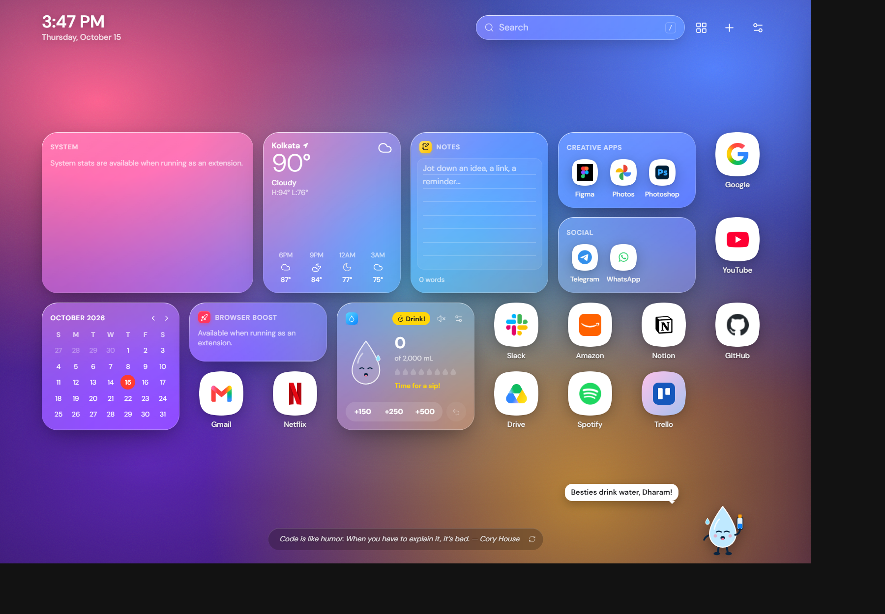

The full-screen preview shows the buddy alongside the dashboard when a drink is overdue. Reduced motion was enabled for the capture to keep the buddy stationary.

#### Buddy on Every Website

The optional **Buddy on every website** setting allows the buddy to appear on other websites. Enabling it requests additional website access. Background reminders and notifications require the installed extension and may depend on browser or operating-system notification settings.

Hover over the buddy on the dashboard, in its preview, or on another website to pause it and show the compact drink pills: Sip (+150 mL), Glass (+250 mL), or Bottle (+500 mL). You can also focus the buddy with Tab and press Enter to reach the drink options. Logging a drink updates the Hydration widget and sends the buddy off with a thank-you.

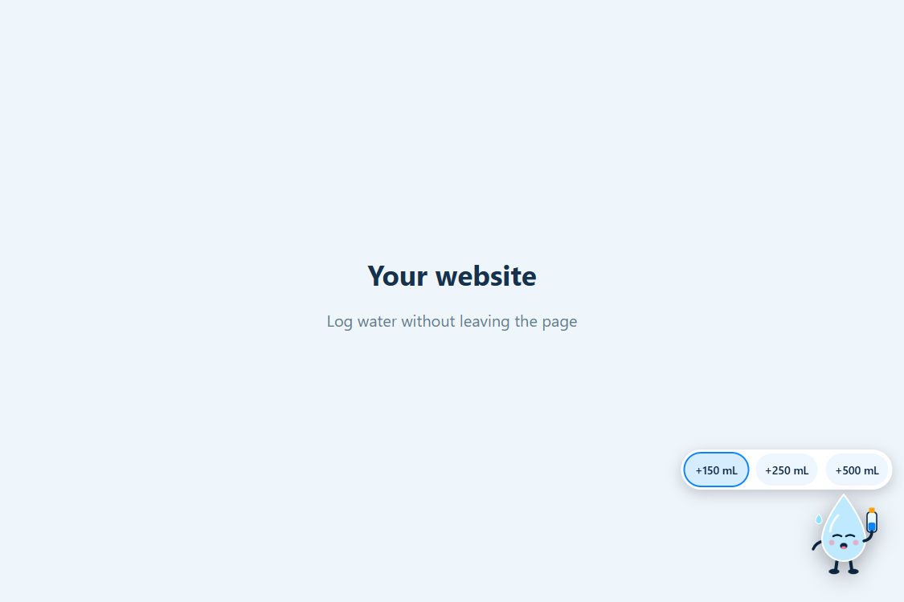

Website-buddy UI preview on a sample webpage, showing the hover-to-log drink options.

### GitHub Integration

Connect a GitHub personal access token through the GitHub Token setting in Glassify Studio. Pull Requests and Contributions require a token; connecting one also increases the available API rate limit for GitHub Repos.

Use a read-only token with only the permissions needed for the information you want to access. Available data depends on the token's permissions and repository access. The extension validates the token with GitHub before saving it.

Tokens are stored in `chrome.storage.local`, not Chrome sync storage, and are excluded from dashboard backups. Use **Disconnect** to remove the saved token. Never commit a token to the repository or paste one into an issue.

### Backup and Restore

Export a JSON backup from Glassify Studio and import it to restore dashboard settings and shortcut tiles. The importer accepts files up to 512 KB.

Backups are not a complete copy of extension storage. They do not include GitHub tokens, uploaded image data, notes, hydration history, or other locally stored widget data. Keep separate copies of custom wallpaper and icon files.

## Data and Permissions

See the [Privacy Policy](docs/privacy-policy.md) for details about stored data, optional permissions, and third-party service requests.

Dashboard settings and shortcut tiles use `chrome.storage.sync`; synchronization depends on your Chrome profile and sync configuration. Custom images, GitHub credentials, and other local widget data use local storage. Startup caches also use localStorage to reduce visual flashing while the dashboard loads.

The extension declares the following permissions in [public/manifest.json](public/manifest.json):

| Permissions | Purpose |
| --- | --- |
| `storage`, `unlimitedStorage` | Save preferences, widget data, and uploaded images. |
| `favicon` | Display website icons for shortcuts. |
| `geolocation` | Support location-based weather. |
| `search` | Use Chrome's search integration. |
| `topSites`, `sessions`, `tabs` | Support most-visited sites, recently closed tabs, tab counts, and browser tools. |
| `system.cpu`, `system.memory` | Display system resource information. |
| `browsingData` | Support browser cleanup actions. |
| `alarms`, `notifications` | Schedule background hydration reminders and show notifications. |
| `scripting` | Support the optional hydration buddy on other websites. |

Host permissions allow requests to Open-Meteo, GitHub, Hacker News, npm, and supported service-status endpoints. Optional access to all websites supports the roaming buddy. Live integrations contact their respective providers; local storage does not mean every feature runs offline.

## Available Commands

| Command | Description |
| --- | --- |
| `npm install` | Install project dependencies. |
| `npm run dev` | Start the Vite development server with hot reload. |
| `npm run build` | Generate the production extension in `dist`. |
| `npm run preview` | Preview the production web build after building. |

The project currently has no configured automated test or lint script. A successful build checks production bundling, but extension-specific behavior still needs testing in Chrome.

## Project Structure

```text
public/
	manifest.json       Chrome extension metadata and permissions
	background.js       Manifest V3 background service worker
	boot.js             Early appearance and wallpaper setup
	buddy.js            Roaming hydration buddy content script
	fonts/              Bundled font files
	icons/              Extension icons
src/
	App.jsx             Main dashboard
	components/         Shared dashboard components
	drawer/             Glassify Studio controls
	layouts/            Dashboard layout implementations
	lib/                API clients and shared utilities
	state/              Defaults, storage, and application state
	widgets/            Productivity, browser, and system widgets
		dev/              Developer-focused widgets
	styles.css          Dashboard styling
vite.config.js        Build configuration and relative asset paths
```

## Troubleshooting

| Problem | What to check |
| --- | --- |
| Chrome cannot load the extension | Run `npm run build` and select the generated `dist` folder. |
| Changes are missing in the installed extension | Rebuild, reload the extension, and open a fresh new tab. |
| Browser widgets do not work in the web preview | Install the unpacked extension to enable Chrome APIs. |
| GitHub data is missing or rate-limited | Check connectivity, token validity, and token permissions. |
| Weather is unavailable | Check connectivity, the configured location, and location permissions. |
| Hydration notifications do not appear | Check reminder settings and Chrome/OS notification permissions. |
| The buddy does not appear on other websites | Enable Buddy on every website and grant website access; Chrome restricts scripts on protected pages such as `chrome://` pages. |
| Another extension controls the new-tab page | Disable the conflicting new-tab extension and reopen a new tab. |

## Tech Stack

- **React 18:** Dashboard components and state-driven rendering.
- **Tailwind CSS 3:** Utility styling alongside custom CSS.
- **Vite 5:** Development server and production bundling.
- **Lucide React:** Interface icons.
- **Chrome Manifest V3:** New-tab override, background service worker, and extension APIs.