# Widget Screenshots and Usage

[Back to the README](../README.md#widget-reference)

This guide covers all 22 widgets available in Glassify Studio. Enable the widgets you want for a layout, then use dashboard edit mode to arrange or resize them.

Screenshots show the real widget components in the local web preview, with sample tasks, notes, reading links, and snippets. Public integrations show data captured at the time of the screenshot; counts, headlines, versions, weather, and times will change. GitHub connection prompts and browser-widget empty or extension-only states are intentional, not simulated account activity or system readings.

Widget data in the web preview is separate from the installed extension. Install the extension for Chrome APIs, background reminders, and desktop notifications. See [installation](../README.md#install-in-chrome) and [GitHub setup](../README.md#github-integration).

- [Productivity](#productivity)
- [Time and Weather](#time-and-weather)
- [Developer](#developer)
- [Browser](#browser)
- [System](#system)
- [Mindfulness](#mindfulness)
- [Finance and Feeds](#finance-and-feeds)

## Productivity

### Tasks

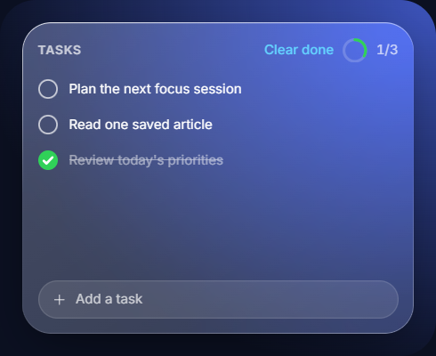

- Type in **Add a task** and press Enter. Check a task to mark it done; completed tasks move below open tasks.
- Use **Clear done** to remove completed tasks, or a task's remove button to delete just that entry. The counter and ring show your progress.

### Notes

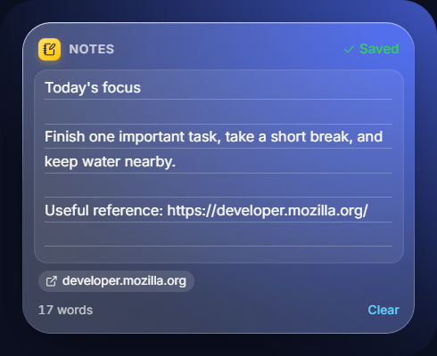

- Type directly into the scratchpad; changes save automatically. The header shows **Saving** or **Saved**, and the footer counts words.
- Web links in the note also appear as clickable shortcuts below it. **Clear** asks for confirmation before removing the note.

### Focus Timer

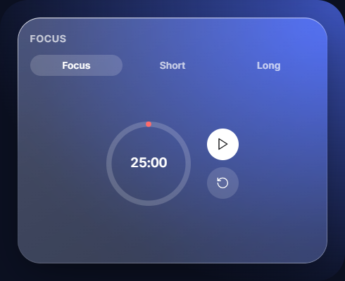

- Choose **Focus** for 25 minutes, **Short** for a 5-minute break, or **Long** for a 15-minute break. Start, pause, or reset with the round controls.
- Changing modes resets the timer. Modes do not switch automatically; completion shows **Done** and attempts to play a chime if browser audio is available.

### Hydration

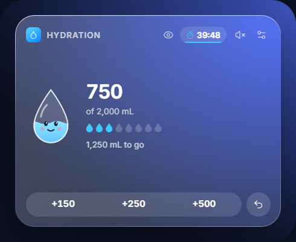

- Log water with **+150**, **+250**, or **+500 mL**; **Undo** reverses the last drink. Settings control the daily goal, reminder interval, buddy, sound, work hours, and notifications.
- Use the eye button to preview the buddy. Hovering over it shows the drink pills; drinks logged in the preview count toward today's intake.
- The bar-chart button opens a monthly report (totals, average, goal days, streaks, and a daily calendar). History is stored only on your device and adapts to any window size.
- See the [Hydration Buddy guide](../README.md#hydration-buddy), including the [buddy on other websites](../README.md#buddy-on-every-website). Website access and background alerts require the installed extension.

### Reading Queue

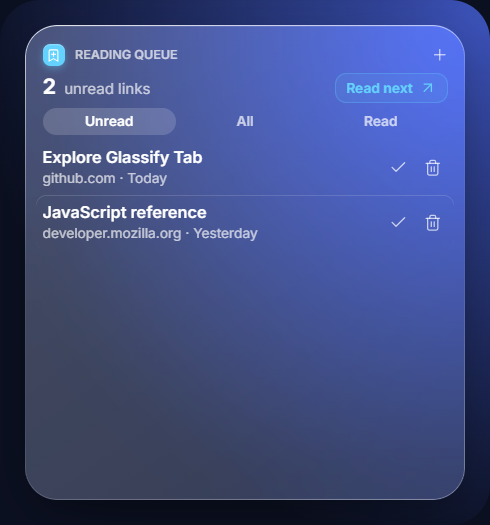

- Use **+** to save an article URL and an optional title. The queue holds up to 50 links and rejects duplicate URLs.
- Choose **Unread**, **All**, or **Read** to filter. **Read next** or opening an article marks it read; the check or reset control lets you change that state manually.
- Use the trash button to remove a saved link.

## Time and Weather

### Weather

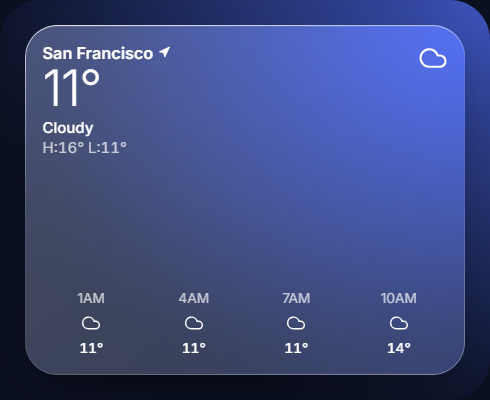

- Set the weather city and temperature unit in Glassify Studio. The card shows current conditions, the day's high and low, and the next forecast hours.
- Requires internet access to Open-Meteo. If data cannot load, the widget displays an unavailable message rather than a forecast.

### Calendar

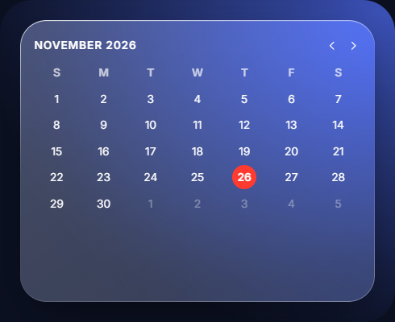

- Use the arrows to browse previous or next months. Today is highlighted; click another date to select it.
- This is a month-view reference, not an event editor or a connection to an external calendar.

### World Clock

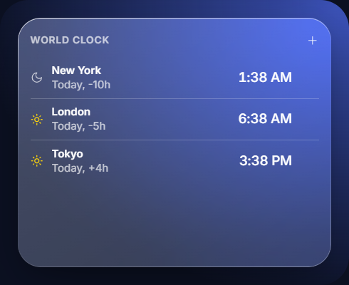

- Use **+**, enter a city or supported time-zone name, and press Enter. Track up to five cities.
- Each row shows the time, relative day and hour offset, and a day or night icon. Remove a city with its remove button.

## Developer

### Dev Toolbox

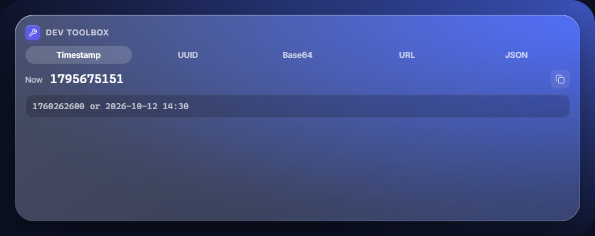

- **Timestamp** converts Unix timestamps or dates. **UUID** generates identifiers, with copy buttons for individual results.
- **Base64** and **URL** encode or decode input; **JSON** formats or minifies it. Copy the output with its copy button.
- These conversions run locally in the widget; the toolbox does not send the input to a conversion service.

### GitHub Repos

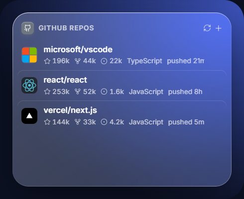

- Use **+** to add `owner/repo` or a GitHub repository URL. Follow up to six repositories; use the remove button to stop following one.
- Open a repository from its name, or refresh its statistics. Public repository data works without a token, subject to GitHub's rate limits; connecting a token increases the available request limit.

### Pull Requests

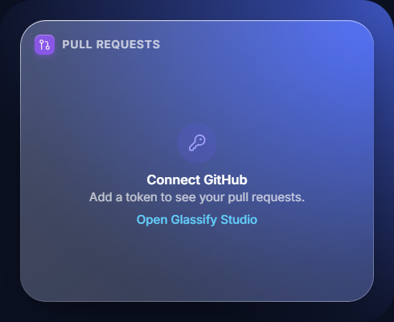

- Connect a GitHub token in Glassify Studio to load your account's pull requests. The screenshot shows the setup prompt before authentication.
- Switch between **My PRs** and **Review requests**, refresh the list, and open a pull request from its title.

### Contributions

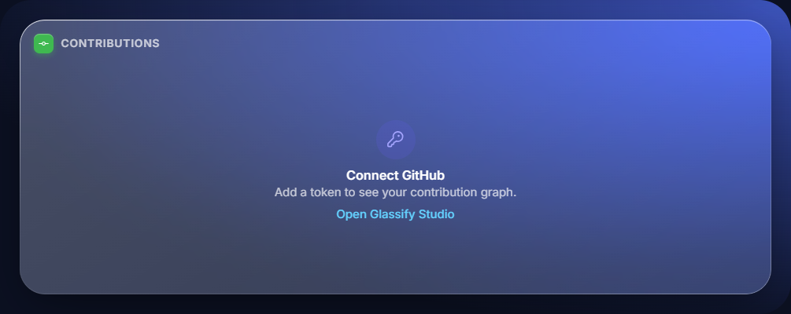

- Connect a GitHub token to show your contribution graph. The screenshot intentionally shows the connection prompt instead of private account data.
- Once connected, the card shows the yearly contribution total, recent activity across up to 26 weeks, and an active streak when present. Hover over a square for its date and contribution count.

### Hacker News

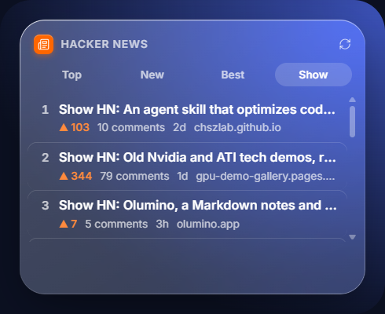

- Choose **Top**, **New**, **Best**, or **Show**. Story titles open articles; comment counts open the corresponding Hacker News discussions.
- Use refresh to request current stories. Internet access is required.

### npm Packages

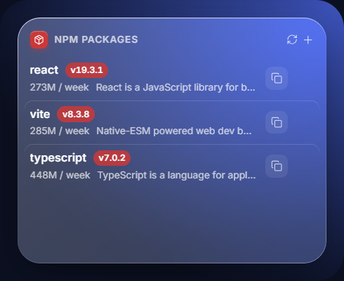

- Use **+** to follow a package by its npm name, including scoped names. Track up to six packages and remove entries you no longer need.
- See the latest version and weekly downloads, open the package page, or copy its `npm i` command. Requires internet access.

### Snippets

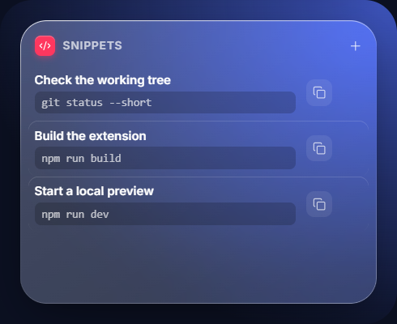

- Use **+** to save code or a command with an optional title. Copy or delete each entry with its row controls.
- Copying a snippet only places text on the clipboard; the widget does not execute it. Keep credentials and other secrets out of saved snippets.

### Localhost

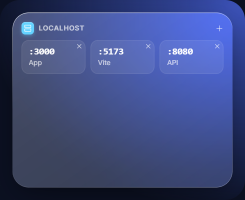

- Use **+** to add a port from 1 to 65535 and an optional label. Keep up to eight shortcuts.
- A shortcut opens `http://localhost:<port>/`. It does not start the server or check whether it is running; start your development server separately.

## Browser

### Most Visited

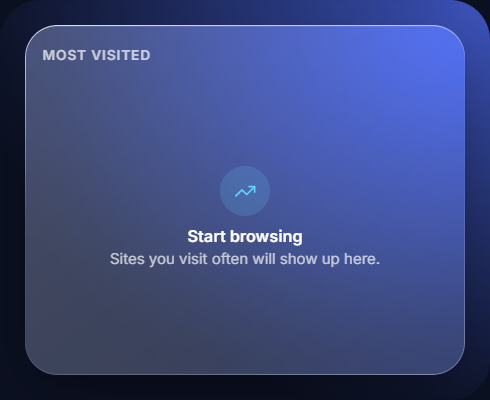

- In the installed extension, the card lists up to six sites supplied by Chrome's most-visited API. Click a row to open the site.
- The web-preview screenshot shows the empty state: the preview cannot read Chrome's browsing activity.

### Recently Closed

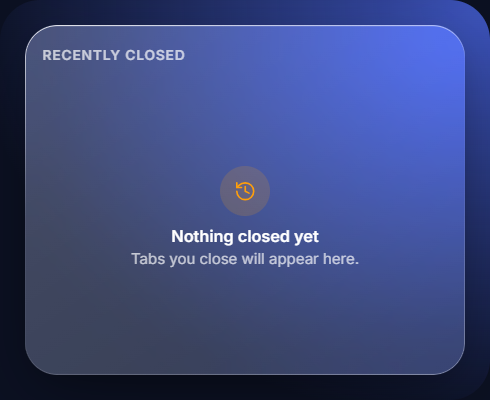

- In the installed extension, reopen recent tabs or windows by clicking their rows. The list excludes closed new-tab dashboard pages.
- Up to six entries are shown. The web preview has no access to Chrome sessions, so its screenshot shows the empty state.

### Browser Boost

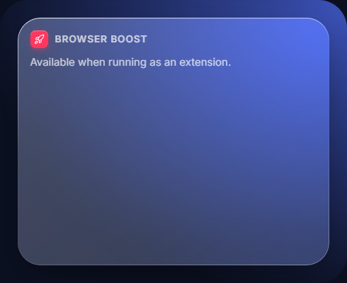

- Requires the installed extension. **Free RAM** puts eligible idle tabs to sleep, **Clean** clears the browser cache, and **Dedupe** closes duplicate tabs.
- Sleeping tabs reload when reopened. Review unsaved work before closing duplicates, and expect cleared cached resources to download again.
- The screenshot shows the extension-only message, not live memory readings or cleanup results.

## System

### System Performance

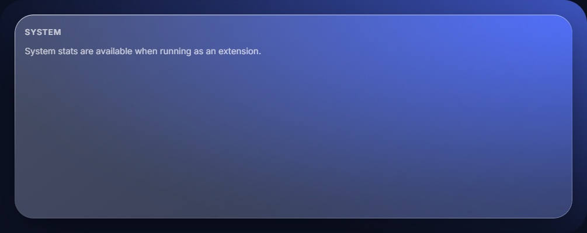

- In the installed extension, monitor CPU load, memory usage, processor information, and open-tab count. Readings refresh automatically.
- The local web preview cannot access Chrome's system APIs; its screenshot shows the availability message instead of fabricated measurements.

## Mindfulness

### Eye Break

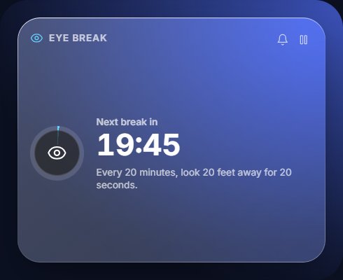

- Every 20 minutes, the reminder prompts you to look about 20 feet away for 20 seconds. Pause or resume it with the header control.
- During a break, **Done for now** finishes the break and starts the next reminder interval.
- The bell tests desktop notifications in the installed extension. Background reminders require the widget to be enabled in a saved layout and depend on Chrome and operating-system notification settings.

## Finance and Feeds

### RSS News Digest

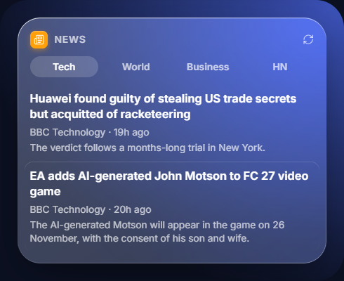

- Choose **Tech**, **World**, **Business**, or **HN** to browse the built-in feeds. Open a headline to read it at its source.
- Headlines are cached; use refresh for a fresh request. Requires internet access. This widget displays news feeds, not a financial portfolio or market-price tracker.
